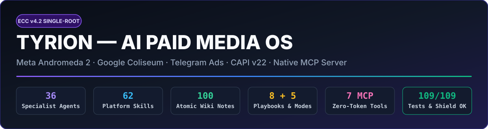

<p align="center">
  
</p>

# 🧠 TYRION v4.0 — AI PAID MEDIA & TARGETOLOGY OPERATING SYSTEM

[](./CHANGELOG.md)
[](./AGENTS.md)
[](./LICENSE)
[](./SECURITY.md)

<!-- tyrion:catalog agents=36 skills=62 wiki=100 -->

**Tyrion v4.0** — `affaan-m/ECC` (*Everything Claude Code*) arxitekturasi asosida qurilgan **yagona ildizli (Single-Root)** raqamli reklama, targetologiya va growth-marketing operatsion tizimi.

Eski ikki-papkali (`claude-ads-main/`) dublikat tuzilma butunlay yo'q qilinib, barcha **36 ta ixtisoslashgan agent**, **62 ta platforma va marketing skilli**, **8 ta amaliy nisha playbooki**, **5 ta dinamik kontekst rejimi**, **16 ta slash buyruq**, **Bilim: atomik qaydlar (100)** va **0-token deterministik Python CLI dvigateli** yagona, toza arxitekturaga birlashtirildi.

## ✨ Tyrion v4.0 Arxitekturasi (Nima o'zgardi?)

```text
tyrion/
├── AGENTS.md                 # Kanonik Agent Shartnomasi (Claude Code, Cursor, Codex, OpenCode)
├── CLAUDE.md                 # Tezkor Router (<=100 qator, 0-token boot)
├── MEMORY.md                 # Operator Xotirasi, O'zbekiston Konteksti va Aktiv Bet Ledger (<=90 qator)
├── INDEX.md                  # Yagona Bilim Xaritasi (MOC)
├── agents/                   # 36 ta Kanonik Agent Charteri (hech qanday dublikat nusxasiz!)
├── skills/                   # 62 ta Kanonik Skill (36 platforma + 26 operator + 39 reference fayl)
├── commands/                 # 16 ta Slash Buyruq (/audit, /auditoriya, /kreativ, /voronka, /scale, /mijoz...)
├── contexts/                 # 5 ta ECC Dynamic Context Mode (audit, launch, scale, creative, uzbekistan)
├── playbooks/                # 8 ta Tayyor Nisha va Platforma Playbooki (Meta $1k-$10k, E-com, Ta'lim, Ko'chmas mulk...)
├── rules/                    # 8 ta Buzilmas Qoida (00-manba .. 70-charter-baseline)
├── wiki/                     # 98 ta Atomik Bilim Qaydi (Andromeda 2, Meta Audience, Google Coliseum, 16 SOP)
├── tools/                    # 19 ta 0-Token Deterministik CLI Asbob (boshqaruv markazi: tools/tyrion.py)
├── hooks/                    # Deterministik Lifecycle Hooklar (SessionStart, PreToolUse, PostToolUse, Stop)
├── templates/                # 6 ta Tayyor Hisobot, Brief va Launch Shablonlari
├── examples/                 # Demo Mijoz Ish Maydoni (examples/demo-brand/)
├── manifests/                # Avto-generatsiya Reestrlari (catalog.json, instincts.json)
└── tests/                    # Avtomatlashtirilgan Unit-Testlar To'plami (stdlib unittest)
```

## 🚀 1. Yagona Master CLI (`tools/tyrion.py`)

Tyrion v4.0 barcha hisob-kitob, auditoriya loyihalash, kreativ matritsa va xavfsizlik tekshiruvlarini **0 token** sarflab bajaradigan markaziy CLI dvigatelga ega:

```bash
# Tizimning umumiy holati va buyruqlar menyusi
python3 tools/tyrion.py status

# Butun tizim sog'lig'ini tekshirish (14 qatlam)
python3 tools/tyrion.py doctor

# TyrionShield 5-qavatli xavfsizlik va governance skaneri
python3 tools/tyrion.py shield
```

## 🎯 2. Meta Ads Audience & Funnel Studio (`tools/meta-audience.py` · `/auditoriya`)

Meta Andromeda 2 algoritmi uchun **7 ta deterministik modul** (+ jonli Meta Graph API v22.0 `adinterest` integratsiyasi):

```bash
# 1) 4-Qatlamli (Broad + High-Intent Stack + Value LAL + BOF) arxitektura va Exclusion matritsasi
python3 tools/meta-audience.py architect --niche real-estate --budget 150 --geo tashkent --has-pixel --has-crm

# 2) 8+ nisha bo'yicha qiziqishlar + O'zbekiston to'lov qobiliyati (Solventnost) filtrlari
python3 tools/meta-audience.py interests --niche edtech
python3 tools/meta-audience.py interests --niche ecom --query "shopping" --live

# 3) Ad Set'lar o'rtasida Auction Overlap (<20% chegara) tekshiruvi
python3 tools/meta-audience.py overlap --size-a 180000 --size-b 120000 --shared 35000

# 4) Auditoriya sig'imi, 14 kunlik Frequency va kreativ charchash kunini (Fatigue Day) bashoratlash
python3 tools/meta-audience.py saturation --audience-size 220000 --daily-budget 80 --cpm 3.5 --days 14

# 5) Dinamik Retargeting Oynalari (3d Hot / 14d Warm Video+DM / 30d Social / 180d Winback)
python3 tools/meta-audience.py retargeting --aov 250 --daily-visitors 400 --ig-engagers 12000 --video-viewers 18000

# 6) Lookalike (LAL) Seed Quality Score (0-100) va O'zbekiston bo'yicha 1%-5% pog'onali hajm hisobi
python3 tools/meta-audience.py lookalike --seed-size 1200 --seed-type purchase_ltv --country UZ

# 7) Metrikalar zanjiridan (CPM -> CTR -> LP/Bot CVR -> Sale) aniq tor joyni (Bottleneck) topish
python3 tools/meta-audience.py diagnose --cpm 3.8 --ctr 0.65 --cpc 0.58 --lp-cvr 12.0 --lead-to-sale 9.0
```

## 🎨 3. Andromeda 2 Creative & Hook Studio (`tools/creative-matrix.py` · `/kreativ`)

```bash
# 3x3 Angle x Format kreativ sinov matritsasi + Uzum/Alif Nasiya narx ankori
python3 tools/creative-matrix.py matrix --niche ecom --product "Klassik erkaklar kostyumi" --price 160

# 3 tilda (O'zbek lotin, O'zbek kirill, Rus) 3 soniyalik Hook variantlari
python3 tools/creative-matrix.py hooks --niche edtech --offer "3 oyda IELTS 7.0 kafolati bilan"

# Hook Rate, Hold Rate va FTIR bo'yicha kreativ charchoq (Fatigue) diagnostikasi
python3 tools/creative-matrix.py fatigue --hook-rate 21.0 --hold-rate 14.5 --ctr-drop-pct 28.0 --frequency 2.9 --ftir 51.0
```

## 🗂️ 4. Mijoz Ish Maydoni Scaffolder (`tools/client-workspace.py` · `/mijoz`)

Yangi mijoz kelganda 1 ta buyruq bilan Break-even ROAS, Target CPA, 70/20/10 byudjet, 4-qatlamli Meta Auditoriya xaritasi va 3x3 Kreativ Matritsani o'z ichiga olgan tayyor ish maydonini yaratadi:

```bash
python3 tools/client-workspace.py new --client "nur-residence" --niche real-estate --budget 3000 --aov 45000 --margin-pct 25 --geo tashkent
```

## ⚡ 5. 16 ta Tezkor Slash Buyruq (`commands/`)

| Buyruq | Vazifasi |
|---|---|
| `/start` | Yangi sessiya yoki loyiha onboardingi (`MEMORY.md` + kontekst rejimi) |
| `/audit` | Meta, Google, Telegram, TikTok va b. bo'yicha 360° manbali akkaunt auditi |
| `/auditoriya` | Meta Ads 4-qatlamli auditoriya, Exclusion, Overlap, Saturation, LAL va Retargeting studiyasi |
| `/kreativ` | Andromeda 2 3x3 kreativ matritsa, 3 soniyalik Hook va Reels skriptlar |
| `/voronka` | **YANGI:** Meta/TG Ads → ManyChat / Telegram Bot → Lead Magnet → AmoCRM voronka arxitektori |
| `/budget` | Break-even CPA/ROAS, Meta 1-5-5 Sandbox, Google Coliseum va Telegram voronka matematikasi |
| `/scale` | **YANGI:** Kill / Keep / Scale qaror dvigateli, +20% byudjet qoidasi va Learning Phase himoyasi |
| `/raqobatchi` | **YANGI:** Raqobatchilar va Meta Ads Library (Longevity, Hook, Offer, Funnel) tahlili |
| `/mijoz` | **YANGI:** 1 buyruqda mijoz uchun tayyor `BRIEF`, `AUDIENCE-MAP`, `CREATIVE-MATRIX` yaratish |
| `/tracking` | Meta Pixel + CAPI (`event_id`), EMQ, GA4, GTM va Telegram Bot UTM tekshiruvi |
| `/hisobot` | Haftalik/oylik ROI, ROAS, ROMI, CAC va MER mijoz hisoboti |
| `/savol` | 98 ta wiki qayd va 8 ta playbook ichidan 0-token javob qidirish |
| `/sop` | 16 ta qadamma-qadam marketing va targetologiya SOP'larini chaqirish |
| `/learn` | Kampaniya saboqlarini `manifests/instincts.json` va `MEMORY.md` ga muhrlash |
| `/shield` | TyrionShield 5-qavatli xavfsizlik skaneri |
| `/doctor` | Butun tizimning 14-nuqtali diagnostikasi |

## 🛠️ O'rnatish (Claude Code / Cursor / Codex)

```bash
# macOS / Linux
./install.sh

# Windows PowerShell
.\install.ps1
```
