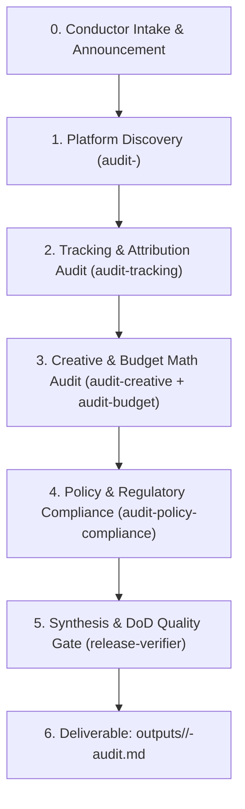

# 🎯 Orchestrator Recipe: Multi-Platform Paid Media Audit

Use this workflow to conduct a full, evidence-based advertising audit for any client or platform.

## Pre-Flight Requirements (Mandatory)

1. **Load Rules**:
   - `rules/00-manba.md`: No unsourced metrics, no benchmark hallucinations.
   - `rules/40-xavfsizlik-va-hisob.md`: Read-only access default; never mutate accounts without written approval.
   - If client in Uzbekistan: `rules/30-ozbekiston-konteksti.md`.
2. **Context Intake**:
   - Read `MEMORY.md` (Operator memory).
   - Check `journal/<client>.md` or `outputs/<client>/` for prior findings.
   - List missing access/data and explicitly ask the user instead of guessing.

## Orchestration Run-Order



### Step 0: Conductor Announcement
Before fanning out to workers, announce the execution plan:
```text
Maqsad: <Client/Account Audit> · Jamoa: <Platform Worker, Tracking, Budget, Release-Verifier>
```

### Step 1: Platform Discovery & Architecture
Delegate to the platform specialist agent (`audit-meta`, `audit-google`, `audit-tiktok`, etc.):
- Campaign structure (Advantage+ / ASC vs manual, CBO vs ABO, search intent vs PMax).
- Learning phase stability & audience overlap / auction collision.
- Frequency and ad fatigue curves.

### Step 2: Conversion Tracking & Data Truth
Delegate to `audit-tracking` / `tracking-specialist`:
- Pixel / SDK and server-side Conversions API (CAPI) match quality.
- Event deduplication (`event_id` parity) and browser vs server latency.
- UTM taxonomy consistency across ad sets and ads.

### Step 3: Creative & Economics Math
Delegate to `audit-creative` and `audit-budget`:
- 3-second hook retention, hold rates, creative format diversity (TOF Problem/Solution vs BOF Objection).
- Blended ROAS, Marketing Efficiency Ratio (MER), Net Free Cash Flow, break-even CPA.

### Step 4: Policy & Brand Safety
Delegate to `audit-policy-compliance`:
- Prohibited claims, before/after imagery, misleading promises, restricted verticals.

### Step 5: Synthesis & Delivery Gate
The conductor collects all findings into a structured file conforming to `rules/50-topshirish-dod.md`:
- Target destination: `outputs/<client>/<date>-<platform>-audit.md`.
- Every finding must contain: `Finding ID`, `Evidence & Metrics`, `Severity` (CRITICAL / HIGH / MEDIUM / LOW), `Actionable Recommendation`, and `Rollback / Reversal steps`.
- Verify with `release-verifier`.
