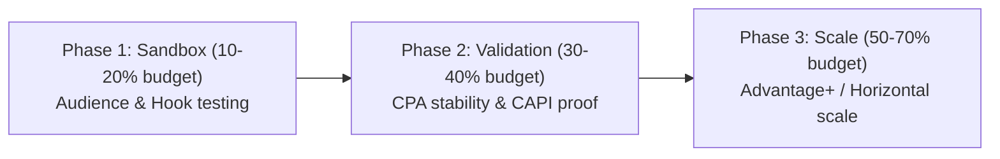
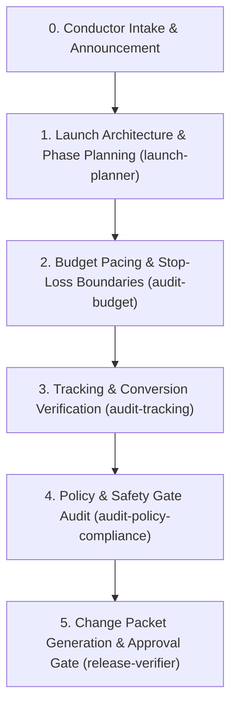

# 🚀 Orchestrator Recipe: Controlled Campaign Launch & Scaling

Use this workflow to launch or scale advertising campaigns across Meta, Google, TikTok, or Telegram with rigorous risk mitigation.

## Pre-Flight Requirements (Mandatory)

1. **Safety Contract (`rules/40-xavfsizlik-va-hisob.md`)**:
   - The AI NEVER mutates live advertising accounts directly.
   - Every launch recommendation must be formulated as a human-executable **Change Packet**.
   - Rollback instructions must be included for every campaign.
2. **Economic Boundaries**:
   - Define Break-even CPA, Target ROAS, Daily Budget Cap, and Stop-Loss limits.

## The 3-Phase Testing Ladder

## Orchestration Run-Order

### Step 1: Launch Plan & Architecture
Delegate to `launch-planner`:
- Campaign structure (Sandbox ABO vs Production CBO/ASC).
- Naming convention: `[TYRION]_[Client]_[Platform]_[Objective]_[Angle]_[Date]`.
- Audience segmentation and exclusion rules (exclude past 30/90 day purchasers).

### Step 2: Budgeting & Kill / Scale Rules
Delegate to `audit-budget`:
- Set daily test budgets (typically 2-3x target CPA per ad set).
- Define deterministic promote & kill rules:
  - **Kill**: If spend > 2x target CPA with 0 conversions -> PAUSE.
  - **Promote**: If CPA <= target CPA and hold rate >= 25% after 50 conversions -> Graduate to Phase 2/3.

### Step 3: Tracking & Funnel Pre-Check
Delegate to `audit-tracking`:
- Verify event firing on landing page / bot funnel.
- Test deduplication parameter (`event_id`).
- Check UTM taxonomy parameters.

### Step 4: The 6 Safety Gates (`rules/40-xavfsizlik-va-hisob.md`)
Audit before drafting the change packet:
1. Budget Cap Gate (Hard daily ceiling defined).
2. Creative Approval Gate (Client-signed visual & copy assets).
3. Target Verification Gate (Geography, age, language exclusions).
4. Policy Compliance Gate (Ad complies with platform guidelines).
5. Rollback Plan Gate (Step-by-step instructions to pause/revert).
6. Human Sign-Off Gate (User explicit confirmation required).

### Step 5: Deliverable Change Packet
Write to `outputs/<client>/<date>-launch-packet.md`:
- Campaign setup checklist.
- Exact budget amounts and bid strategy.
- Ad asset mappings (Headline, Primary Text, Creative ID, UTM URL).
- Emergency rollback procedure.
