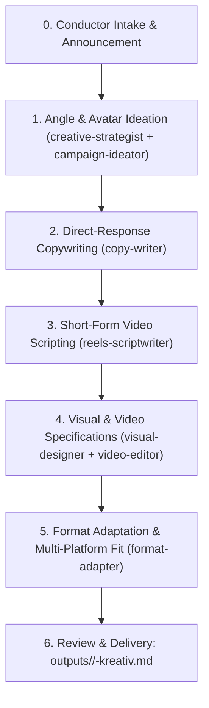

# 🎨 Orchestrator Recipe: Creative Strategy & Production Sprint

Use this workflow to generate high-converting, fatigue-resistant ad creatives, scripts, and visual assets based on the principle: **Creative is Targeting** (`[[content-is-targeting]]`).

## Pre-Flight Requirements

1. **Load Rules & Principles**:
   - `rules/00-manba.md`: Ground claims in real customer voice, reviews, or transcripts.
   - `rules/30-ozbekiston-konteksti.md`: Native cultural nuances, separate scripts for Uzbek Latin, Uzbek Cyrillic, and Russian (never literal translation).
   - Core knowledge: `[[funnel-2-kreativ-format]]` (TOF problem-solution & BOF objection-handling), `[[unique-mexanizm]]`, `[[kreativ-hit-rate]]`.
2. **Customer & Brand Intake**:
   - Avatar ICP, primary pains, objections, and Unique Mechanism.

## Orchestration Run-Order



### Step 0: Conductor Announcement
```text
Maqsad: <Creative Sprint / Offer Launch> · Jamoa: <creative-strategist, copy-writer, reels-scriptwriter, visual-designer, video-editor>
```

### Step 1: Angle & Avatar Architecture
Delegate to `creative-strategist` and `campaign-ideator`:
- Define 3-5 distinct Angles (Pain-driven, Outcome-driven, Us-vs-Them, Skeptic/Mechanism).
- Identify key avatar desires and burning objections.

### Step 2: Direct-Response Ad Copy
Delegate to `copy-writer`:
- 3 distinct hook variations per angle (curiosity, bold claim, call-out).
- Value body (Bridge-Promise-Proof) conforming to `rules/30-ozbekiston-konteksti.md`.
- Explicit, low-friction Call to Action (CTA).

### Step 3: Short-Form Video Scripting (9:16)
Delegate to `reels-scriptwriter`:
- First 3 seconds: Visual hook + audio hook pattern interrupt.
- Narrative arc: Problem -> Agitation -> Mechanism Reveal -> Proof -> Offer -> CTA.
- Pacing: scene length, on-screen text (OST), B-roll directions.

### Step 4: Visual Design & Video Editing Spec
Delegate to `visual-designer` and `video-editor`:
- Aspect ratios: 9:16 (Stories/Reels/TikTok), 1:1 / 4:5 (Feeds), 16:9 (YouTube).
- Color grading guidelines (no over-saturation), clean typography, safe zones.
- Export specs: ProRes / H.264, 4K/1080p, 30fps, target bitrate.

### Step 5: Deliverable Package
Synthesize into `outputs/<client>/<date>-kreativ.md`:
- Angle Matrix table
- Copy variations by language
- Script storyboards with timestamp markers
- Visual design & video production checklist
