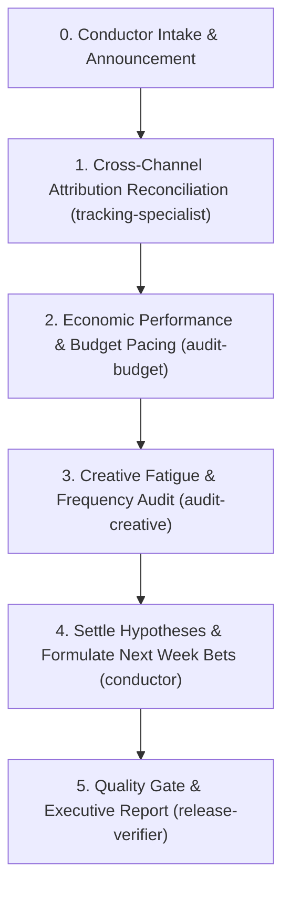

# 📊 Orchestrator Recipe: Weekly Account Review & Bet Settlement

Use this workflow to conduct a weekly performance review, reconcile cross-channel attribution, settle test bets, and generate an executive weekly report.

## Pre-Flight Requirements

1. **Attribution & Financial Ground Truth**:
   - Primary metric: **Blended ROAS** and **Net Free Cash Flow** (`[[blended-roas-net-cash]]`).
   - Platform in-dashboard ROAS is treated as directional, not absolute truth.
2. **Context Intake**:
   - Read `MEMORY.md` (Operator memory & lessons learned).
   - Read `journal/<client>.md` (Prior week bets, hypotheses, and decisions).

## Orchestration Run-Order

### Step 1: Attribution Reconciliation
Delegate to `tracking-specialist`:
- Compare CRM / backend revenue vs platform-reported revenue.
- Calculate blended ROAS: `Total Revenue / Total Ad Spend`.
- Check channel contribution (Meta vs Google vs Telegram vs TikTok).

### Step 2: Budget Pacing & Unit Economics
Delegate to `audit-budget`:
- Monthly spend pace (% of monthly budget utilized vs calendar days passed).
- CPA trends (CPA delta week-over-week).
- Net cash generated after ad spend and COGS.

### Step 3: Creative Fatigue & Saturation
Delegate to `audit-creative`:
- Frequency trends on top creative assets.
- First-time impression ratio (FTIR).
- 3-second hook drop-off changes.
- Identify winning angles ready for iteration (`[[ad-iteration]]`).

### Step 4: Settle Bets & Log Lessons
- Evaluate test hypotheses set last week (Confirmed / Refuted / Inconclusive).
- Formulate 1-3 new falsifiable bets for next week.
- Update `MEMORY.md` (§6 Lessons) with verified findings.

### Step 5: Deliverable: Weekly Report
Synthesize into `outputs/<client>/<date>-haftalik-hisobot.md`:
- Executive summary (3 bullet points).
- Key numbers table (Spend, Revenue, Blended ROAS, CPA, Net Cash).
- Kill / Keep / Scale decisions with clear rationales.
- Next week's action plan with owner and deadlines.
- Append summary note to `journal/<client>.md` and 1 line to `LOG.md`.
